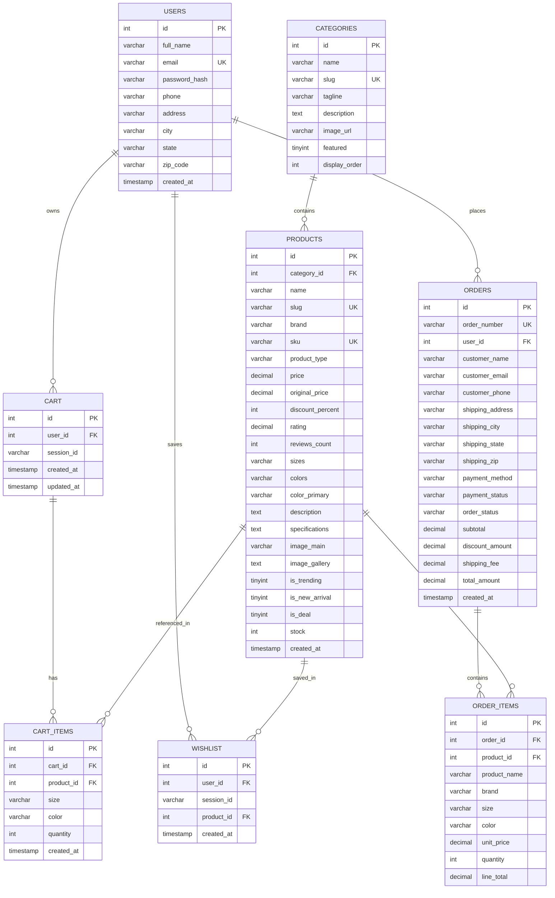

# SportKick — Academic Project Report Data Collection Document

> **Document Purpose:** Comprehensive technical audit and verified data collection report for the **SportKick** mini project. All information in this document has been extracted and verified directly from the project source code, live MySQL database (`sportkick_db`), automated verification suite, and running application.

---

## 1. Project Title and Subtitle
- **Project Title:** SportKick
- **Project Subtitle:** A Dedicated Full-Stack Sportswear and Performance Sports Footwear E-Commerce Platform
- **Hero Brand Tagline:** *"PUSH BEYOND LIMITS. Performance starts with what you wear."*

---

## 2. Problem Statement
General-purpose e-commerce marketplaces treat technical athletic equipment as ordinary casual clothing, lacking sport-specific categorization, discipline-grade technical specifications (such as heel-to-toe drop, midsole compound, soleplate stud configuration, court surface compatibility, or waterproof ratings), and rapid multi-parameter filtering by sport, shoe size, colorway, and price range. Furthermore, many academic or entry-level e-commerce prototypes rely on hardcoded static HTML arrays rather than persistent relational databases, secure session authentication, or transactional order processing.

There is a clear need for a dedicated, database-driven sportswear and athletic footwear e-commerce platform that organizes equipment across distinct competitive sports, exposes granular technical specifications for informed athlete selection, and implements complete server-side cart, wishlist, promotional pricing, authentication, and order fulfillment workflows in Indian Rupees (`₹` INR).

---

## 3. Introduction
**SportKick** is a full-stack web-based e-commerce application developed using **HTML5, Custom CSS3, Vanilla JavaScript (ES6+), PHP 8.5, and MySQL**. Inspired by global athletic brands including **Nike, Adidas, Puma, and Foot Locker**, the platform delivers a high-contrast Carbon Black (`#09090B`), Studio Alabaster (`#F5F5F7`), Pure White (`#FFFFFF`), and Electric Orange (`#FF5500`) user interface tailored for athletes across **8 core sports categories**:
1. Running
2. Basketball
3. Football
4. Cricket
5. Tennis
6. Badminton
7. Gym & Training
8. Hiking

All catalog data, user accounts, shopping carts, wishlists, and customer orders are persisted in a normalized 8-table MySQL relational database (`sportkick_db`) accessed exclusively via PHP Data Objects (PDO) prepared statements. The frontend communicates with modular PHP JSON APIs (`api/*.php`) to provide seamless, page-reload-free interactions for adding items to the shopping bag, toggling wishlists, inspecting products via a Quick View modal, applying promotional codes, and completing checkout.

---

## 4. Objectives of the Project
1. **Sport-Centric Catalog Organization:** Structure products across 8 dedicated sports categories (*Running, Basketball, Football, Cricket, Tennis, Badminton, Gym & Training, Hiking*) with sport-specific descriptions and technical specifications.
2. **Dynamic MySQL Persistence:** Eliminate hardcoded frontend product arrays by storing and retrieving all 24 initial products, 8 categories, user profiles, carts, wishlists, and orders from MySQL (`sportkick_db`).
3. **Advanced Search and Multi-Faceted Filtering:** Enable users to search by product name, brand, description, category, or SKU, and simultaneously filter by sport category, brand, price range (`₹`), size (`UK 6`–`UK 12`, `S`–`XXL`), colorway, equipment type (*Footwear* / *Apparel*), and 6 sorting modes.
4. **Asynchronous Cart & Wishlist Management:** Implement real-time AJAX operations for adding/removing products, adjusting quantities, calculating markdown savings, applying promotional discount codes (`KICK10`, `ATHLETE20`), and automatically merging guest session data into authenticated user accounts upon login.
5. **Secure Authentication & Transactional Checkout:** Enforce server-side validation, bcrypt password hashing (`password_hash()` / `password_verify()`), and atomic MySQL transactions (`BEGIN` / `COMMIT` / `ROLLBACK`) during checkout to record orders (`orders`, `order_items`) and decrement product stock accurately.
6. **Responsive Athletic UI/UX:** Deliver a mobile-, tablet-, and desktop-responsive interface using custom CSS Grid and Flexbox layouts without relying on heavy third-party UI frameworks.

---

## 5. Technologies Used and Their Purposes

| Category | Technology / Tool | Version (Verified) | Purpose in SportKick |
| :--- | :--- | :--- | :--- |
| **Frontend Markup** | HTML5 | Living Standard | Semantic page structure (`header`, `nav`, `main`, `section`, `article`, `aside`, `footer`), accessible forms, and modal dialogs |
| **Frontend Styling** | Custom CSS3 (`assets/css/style.css`) | CSS3 (2,177 lines) | Custom design system with CSS variables, responsive grids, sticky glassmorphism navigation, product card hover animations, and media queries |
| **Typography** | Google Fonts | *Barlow Condensed* & *Plus Jakarta Sans* | Bold condensed italic athletic display headlines paired with high-legibility UI and specification typography |
| **Client-Side Logic** | JavaScript (`assets/js/main.js`) | ECMAScript 2015+ (ES6+) | `fetch()` AJAX calls to backend APIs, DOM manipulation, Quick View modal rendering, gallery thumbnail switching, size/color pill selection, and toast notifications |
| **Server-Side Scripting** | PHP | PHP 8.5.12 (CLI / Built-in Server) | Dynamic HTML rendering, session management, business logic, form validation, and RESTful JSON API endpoints |
| **Database Engine** | MySQL | MySQL 26.10.0 (Homebrew arm64) | Relational data storage (`InnoDB` engine, `utf8mb4_unicode_ci` collation) for users, categories, products, carts, wishlists, and orders |
| **Database Driver** | PHP PDO (`pdo_mysql`) | Built-in PHP 8.5 | Secure database connectivity using prepared statements (`PDO::ATTR_EMULATE_PREPARES => false`) and transaction management |
| **Version Control** | Git & GitHub CLI (`gh`) | Git 2.56.0 | Source code version control and remote repository hosting at `https://github.com/Mukund220304/sportkick` |

---

## 6. Software and Hardware Requirements

### 6.1 Verified Development & Test Environment
- **Operating System:** macOS 27.2 (Build `26B123`, `arm64`)
- **Processor (CPU):** Apple M5
- **Memory (RAM):** 16 GB (`17,179,869,184` bytes)
- **PHP Runtime:** PHP 8.5.12 (with Zend Engine v4.5.12 and Zend OPcache v8.5.12)
- **Database Server:** MySQL Ver 26.10.0 for macOS on `arm64` (Homebrew)
- **Web Browser:** Google Chrome 157.0.8103.51
- **Version Control:** Git 2.56.0

### 6.2 Minimum Target Requirements for Deployment / Evaluation
- **Operating System:** Windows 10/11, macOS 12+, or Ubuntu Linux 20.04+
- **Processor:** Intel Core i3 / AMD Ryzen 3 / Apple M1 or higher (2.0 GHz+)
- **RAM:** Minimum 4 GB (8 GB recommended)
- **Storage:** 150 MB free disk space
- **Software Stack:** PHP 8.0+ (or XAMPP / WAMP / MAMP stack), MySQL 8.0+ / MariaDB 10.5+, any modern web browser (Chrome, Firefox, Edge, Safari)

---

## 7. Main Modules and Their Functionalities

### Module 1: Database Connection & Auto-Bootstrap Module (`config/database.php`)
- Establishes a singleton `PDO` connection to `sportkick_db` (`127.0.0.1:3306` with fallback to `localhost` Unix socket).
- Configures `PDO::ATTR_ERRMODE => PDO::ERRMODE_EXCEPTION`, `PDO::ATTR_DEFAULT_FETCH_MODE => PDO::FETCH_ASSOC`, and `PDO::ATTR_EMULATE_PREPARES => false`.
- Automatically detects if `sportkick_db` is missing on a fresh installation and executes `database/sportkick.sql` to create all 8 tables and seed initial data.

### Module 2: Catalog & Multi-Faceted Search/Filter Module (`index.php`, `shop.php`, `api/products.php`, `includes/functions.php`)
- Renders the Home page (`index.php`) with the hero banner, partner brand strip, 8 sport category cards with live item counts, Trending Athlete Picks (`is_trending = 1`), Exclusive Deals (`is_deal = 1`), and New Season Arrivals (`is_new_arrival = 1`).
- Powers `queryProducts(PDO $pdo, array $filters)` in `includes/functions.php`, supporting dynamic SQL `WHERE` clauses for:
  - Keyword search (`q`) across `p.name`, `p.brand`, `p.description`, `c.name`, and `p.sku`
  - Sport Category (`category` by slug or ID)
  - Brand (`brand` single or array)
  - Price Range (`min_price`, `max_price` in `₹`)
  - Size (`FIND_IN_SET(:size_exact, p.sizes) > 0`)
  - Colorway (`p.color_primary = :color_primary OR FIND_IN_SET(:color_set, p.colors) > 0`)
  - Equipment Type (`Footwear` or `Apparel`)
  - Collection Badge (`trending`, `new`, `deal`)
  - 6 Sorting modes (`featured`, `price_asc`, `price_desc`, `rating`, `discount`, `newest`)

### Module 3: Product Details & Quick View Module (`product.php`, `api/products.php`, `includes/product_card.php`)
- Displays multi-angle product photography with an interactive thumbnail switcher (`pd-thumb`).
- Parses JSON `specifications` into a structured technical specifications table (Upper, Midsole, Outsole, Weight, Surface, etc.).
- Provides interactive size pills, colorway buttons, quantity stepper (`1`–`10`), live stock availability badge, and dollar/rupee markdown savings calculation.
- Queries 4 related products from the same sport category.
- Serves `/api/products.php?action=detail&id={id}` for the asynchronous Quick View modal on any product card.

### Module 4: Shopping Cart & Promotional Pricing Module (`cart.php`, `api/cart.php`, `includes/functions.php`)
- Supports both guest sessions (tracked via `session_id()`) and authenticated users (tracked via `user_id`).
- Provides `add`, `update`, `remove`, `clear`, and `promo` actions via `api/cart.php`.
- Calculates item subtotals, original price markdown savings, promotional code discounts (`KICK10` = 10% off any order; `ATHLETE20` = 20% off orders `₹10,000+`), and express shipping fee (`FREE` on net orders `>= ₹4,999`, otherwise `₹199`).

### Module 5: Wishlist Module (`wishlist.php`, `api/wishlist.php`)
- Allows guests and logged-in athletes to toggle favorite products (`action: toggle`), remove items (`action: remove`), or move a product directly from the wishlist into the shopping cart (`action: move_to_cart`).
- Updates the header wishlist badge counter (`#headerWishlistCount`) in real time.

### Module 6: Authentication, Session Sync & Athlete Profile Module (`login.php`, `register.php`, `profile.php`, `logout.php`, `api/auth.php`)
- Handles user registration (`action: register`) with full name, email format validation, duplicate email check (`HTTP 409`), password length check (`>= 6` chars), and `password_hash($password, PASSWORD_DEFAULT)`.
- Handles user login (`action: login`) with `password_verify()` and includes a 1-click **Auto-Fill Demo** button on `login.php` for `athlete@sportkick.com`.
- Executes `syncGuestDataOnLogin()` upon login or registration to merge any guest `cart_items` and `wishlist` records into the user's persistent account.
- Provides `profile.php` for updating contact/delivery address details (`action: update_profile`), changing passwords (`action: change_password`), and viewing complete itemized order history.

### Module 7: Transactional Checkout & Order Fulfillment Module (`checkout.php`, `api/checkout.php`)
- Validates customer contact info (`customer_name`, `customer_email`, `customer_phone`), delivery address (`shipping_address`, `shipping_city`, `shipping_state`, `shipping_zip`), and payment method (*Credit / Debit Card, UPI / Instant Pay, Net Banking, Cash on Delivery*).
- Executes order placement inside a database transaction (`$pdo->beginTransaction()` -> `$pdo->commit()`):
  1. Generates a unique order number (`SK-YYYY-XXXXX`).
  2. Inserts the master record into `orders`.
  3. Inserts each line item into `order_items`.
  4. Decrements product inventory in `products` (`stock = GREATEST(0, stock - :qty)`).
  5. Saves the delivery address to the logged-in user's profile.
  6. Clears `cart_items` and active promo session state.
- Renders the Order Confirmation Receipt (`checkout.php?order=SK-YYYY-XXXXX`).

---

## 8. Database Structure (`sportkick_db`)

### 8.1 Entity-Relationship Diagram

### 8.2 Detailed Table Schemas

#### Table 1: `users`
| Column | Data Type | Constraints | Description |
| :--- | :--- | :--- | :--- |
| `id` | `INT` | `AUTO_INCREMENT PRIMARY KEY` | Unique athlete user ID |
| `full_name` | `VARCHAR(120)` | `NOT NULL` | Full name of the user |
| `email` | `VARCHAR(150)` | `NOT NULL UNIQUE` | Login email address |
| `password_hash` | `VARCHAR(255)` | `NOT NULL` | Bcrypt password hash |
| `phone` | `VARCHAR(30)` | `DEFAULT ''` | Contact phone number |
| `address` | `VARCHAR(255)` | `DEFAULT ''` | Street delivery address |
| `city` | `VARCHAR(100)` | `DEFAULT ''` | City name |
| `state` | `VARCHAR(100)` | `DEFAULT ''` | State / province |
| `zip_code` | `VARCHAR(20)` | `DEFAULT ''` | Postal / PIN code |
| `created_at` | `TIMESTAMP` | `DEFAULT CURRENT_TIMESTAMP` | Account registration timestamp |

*Seeded Records (2):* `athlete@sportkick.com` (Aarav Sharma, Bengaluru) and `nithilan@sportkick.com` (Nithilan K, Chennai).

#### Table 2: `categories`
| Column | Data Type | Constraints | Description |
| :--- | :--- | :--- | :--- |
| `id` | `INT` | `AUTO_INCREMENT PRIMARY KEY` | Unique category ID (`1`–`8`) |
| `name` | `VARCHAR(100)` | `NOT NULL` | Display name (*Running, Basketball, Football, Cricket, Tennis, Badminton, Gym & Training, Hiking*) |
| `slug` | `VARCHAR(100)` | `NOT NULL UNIQUE` | URL-friendly slug (`running`, `basketball`, etc.) |
| `tagline` | `VARCHAR(180)` | `NOT NULL` | Short technical subtitle |
| `description` | `TEXT` | `NULL` | Full category description |
| `image_url` | `VARCHAR(500)` | `NOT NULL` | Category banner image URL |
| `featured` | `TINYINT(1)` | `DEFAULT 1` | Featured flag on Home page |
| `display_order` | `INT` | `DEFAULT 0` | Navigation sort order |

#### Table 3: `products`
| Column | Data Type | Constraints | Description |
| :--- | :--- | :--- | :--- |
| `id` | `INT` | `AUTO_INCREMENT PRIMARY KEY` | Unique product ID (`1`–`24`) |
| `category_id` | `INT` | `NOT NULL, FK -> categories(id) ON DELETE CASCADE` | Associated sport category |
| `name` | `VARCHAR(180)` | `NOT NULL` | Product title |
| `slug` | `VARCHAR(200)` | `NOT NULL UNIQUE` | URL slug |
| `brand` | `VARCHAR(80)` | `NOT NULL, INDEX` | Brand (*Nike, Adidas, Puma, Asics, Under Armour, Yonex, Salomon*) |
| `sku` | `VARCHAR(60)` | `NOT NULL UNIQUE` | Stock Keeping Unit (`SK-RUN-001`, etc.) |
| `product_type` | `VARCHAR(40)` | `NOT NULL DEFAULT 'Footwear'` | `Footwear` or `Apparel` |
| `price` | `DECIMAL(10,2)` | `NOT NULL, INDEX` | Selling price in `₹` INR (`₹3,599` – `₹18,499`) |
| `original_price` | `DECIMAL(10,2)` | `NOT NULL` | MRP / strike-through price in `₹` INR |
| `discount_percent` | `INT` | `NOT NULL DEFAULT 0` | Discount percentage (`15%` – `25%`) |
| `rating` | `DECIMAL(3,2)` | `NOT NULL DEFAULT 4.50` | Average athlete rating (`4.60` – `4.95`) |
| `reviews_count` | `INT` | `NOT NULL DEFAULT 0` | Number of verified reviews |
| `sizes` | `VARCHAR(255)` | `NOT NULL` | Comma-separated available sizes (`UK 6,UK 7...` or `S,M,L,XL`) |
| `colors` | `VARCHAR(255)` | `NOT NULL` | Comma-separated available colorways |
| `color_primary` | `VARCHAR(50)` | `NOT NULL, INDEX` | Primary filter color |
| `description` | `TEXT` | `NOT NULL` | Detailed product description |
| `specifications` | `TEXT` | `NOT NULL` | JSON object of technical specifications |
| `image_main` | `VARCHAR(500)` | `NOT NULL` | Primary product studio image URL |
| `image_gallery` | `TEXT` | `NOT NULL` | JSON array of multi-angle gallery image URLs |
| `is_trending` | `TINYINT(1)` | `DEFAULT 0` | Trending section flag |
| `is_new_arrival` | `TINYINT(1)` | `DEFAULT 0` | New arrivals section flag |
| `is_deal` | `TINYINT(1)` | `DEFAULT 0` | Exclusive deals section flag |
| `stock` | `INT` | `NOT NULL DEFAULT 25` | Available inventory count |
| `created_at` | `TIMESTAMP` | `DEFAULT CURRENT_TIMESTAMP` | Creation timestamp |

#### Table 4: `cart`
| Column | Data Type | Constraints | Description |
| :--- | :--- | :--- | :--- |
| `id` | `INT` | `AUTO_INCREMENT PRIMARY KEY` | Unique cart ID |
| `user_id` | `INT` | `NULL, FK -> users(id) ON DELETE CASCADE` | Linked user ID (null for guests) |
| `session_id` | `VARCHAR(128)` | `NOT NULL, INDEX` | PHP session identifier |
| `created_at` | `TIMESTAMP` | `DEFAULT CURRENT_TIMESTAMP` | Creation timestamp |
| `updated_at` | `TIMESTAMP` | `ON UPDATE CURRENT_TIMESTAMP` | Last modification timestamp |

#### Table 5: `cart_items`
| Column | Data Type | Constraints | Description |
| :--- | :--- | :--- | :--- |
| `id` | `INT` | `AUTO_INCREMENT PRIMARY KEY` | Unique cart line item ID |
| `cart_id` | `INT` | `NOT NULL, FK -> cart(id) ON DELETE CASCADE` | Parent cart ID |
| `product_id` | `INT` | `NOT NULL, FK -> products(id) ON DELETE CASCADE` | Product ID |
| `size` | `VARCHAR(30)` | `NOT NULL DEFAULT 'UK 9'` | Selected size |
| `color` | `VARCHAR(50)` | `NOT NULL DEFAULT 'Black'` | Selected colorway |
| `quantity` | `INT` | `NOT NULL DEFAULT 1` | Quantity (`1`–`10`) |
| `created_at` | `TIMESTAMP` | `DEFAULT CURRENT_TIMESTAMP` | Added timestamp |
| *Unique Key* | `uq_cart_product_variant` | `UNIQUE (cart_id, product_id, size, color)` | Prevents duplicate rows for the same variant |

#### Table 6: `wishlist`
| Column | Data Type | Constraints | Description |
| :--- | :--- | :--- | :--- |
| `id` | `INT` | `AUTO_INCREMENT PRIMARY KEY` | Unique wishlist entry ID |
| `user_id` | `INT` | `NULL, FK -> users(id) ON DELETE CASCADE` | Linked user ID |
| `session_id` | `VARCHAR(128)` | `DEFAULT '', INDEX` | Guest session ID |
| `product_id` | `INT` | `NOT NULL, FK -> products(id) ON DELETE CASCADE` | Saved product ID |
| `created_at` | `TIMESTAMP` | `DEFAULT CURRENT_TIMESTAMP` | Saved timestamp |

#### Table 7: `orders`
| Column | Data Type | Constraints | Description |
| :--- | :--- | :--- | :--- |
| `id` | `INT` | `AUTO_INCREMENT PRIMARY KEY` | Internal order ID |
| `order_number` | `VARCHAR(40)` | `NOT NULL UNIQUE` | Public order reference (`SK-2026-84920`) |
| `user_id` | `INT` | `NULL, FK -> users(id) ON DELETE SET NULL` | Placing user ID |
| `customer_name` | `VARCHAR(120)` | `NOT NULL` | Recipient full name |
| `customer_email` | `VARCHAR(150)` | `NOT NULL` | Confirmation email |
| `customer_phone` | `VARCHAR(30)` | `NOT NULL` | Contact phone |
| `shipping_address` | `VARCHAR(255)` | `NOT NULL` | Street address |
| `shipping_city` | `VARCHAR(100)` | `NOT NULL` | City |
| `shipping_state` | `VARCHAR(100)` | `NOT NULL` | State |
| `shipping_zip` | `VARCHAR(20)` | `NOT NULL` | Postal / PIN code |
| `payment_method` | `VARCHAR(50)` | `NOT NULL` | Card, UPI, Net Banking, or COD |
| `payment_status` | `VARCHAR(40)` | `NOT NULL DEFAULT 'Paid'` | `Paid` or `Pending (COD)` |
| `order_status` | `VARCHAR(40)` | `NOT NULL DEFAULT 'Confirmed'` | Order fulfillment state |
| `subtotal` | `DECIMAL(10,2)` | `NOT NULL` | Pre-discount item subtotal (`₹`) |
| `discount_amount` | `DECIMAL(10,2)` | `NOT NULL DEFAULT 0.00` | Promo discount amount (`₹`) |
| `shipping_fee` | `DECIMAL(10,2)` | `NOT NULL DEFAULT 0.00` | Shipping charge (`₹0` or `₹199`) |
| `total_amount` | `DECIMAL(10,2)` | `NOT NULL` | Final amount payable (`₹`) |
| `created_at` | `TIMESTAMP` | `DEFAULT CURRENT_TIMESTAMP` | Order timestamp |

#### Table 8: `order_items`
| Column | Data Type | Constraints | Description |
| :--- | :--- | :--- | :--- |
| `id` | `INT` | `AUTO_INCREMENT PRIMARY KEY` | Order line item ID |
| `order_id` | `INT` | `NOT NULL, FK -> orders(id) ON DELETE CASCADE` | Parent order ID |
| `product_id` | `INT` | `NULL, FK -> products(id) ON DELETE SET NULL` | Purchased product ID |
| `product_name` | `VARCHAR(180)` | `NOT NULL` | Snapshot of product name at purchase |
| `brand` | `VARCHAR(80)` | `NOT NULL` | Snapshot of brand |
| `size` | `VARCHAR(30)` | `NOT NULL` | Purchased size |
| `color` | `VARCHAR(50)` | `NOT NULL` | Purchased colorway |
| `unit_price` | `DECIMAL(10,2)` | `NOT NULL` | Unit price in `₹` |
| `quantity` | `INT` | `NOT NULL` | Quantity purchased |
| `line_total` | `DECIMAL(10,2)` | `NOT NULL` | `unit_price * quantity` (`₹`) |

---

## 9. Application Architecture
SportKick follows a **3-Tier Modular Web Architecture**:
1. **Presentation Tier (Client Browser):**
   - Server-rendered HTML5 templates (`index.php`, `shop.php`, `product.php`, `cart.php`, `wishlist.php`, `checkout.php`, `login.php`, `register.php`, `profile.php`) sharing common layout partials (`includes/header.php`, `includes/footer.php`, `includes/product_card.php`).
   - Styled via `assets/css/style.css` and enhanced with client-side interactivity via `assets/js/main.js`.
2. **Application / Business Logic Tier (PHP 8.5):**
   - **Data Access & Helper Layer (`includes/functions.php`):** Centralizes `queryProducts()`, `getCartDetails()`, `getOrCreateCartId()`, `syncGuestDataOnLogin()`, `getWishlistItems()`, and `formatPrice()`.
   - **RESTful JSON API Layer (`api/*.php`):** Processes asynchronous `fetch()` requests from `main.js` and page scripts (`api/products.php`, `api/cart.php`, `api/wishlist.php`, `api/auth.php`, `api/checkout.php`) and returns structured JSON responses with appropriate HTTP status codes (`200`, `400`, `401`, `404`, `409`, `500`).
3. **Data Persistence Tier (MySQL `sportkick_db`):**
   - Managed via singleton PDO connection (`config/database.php`) enforcing prepared statements and relational integrity across all 8 InnoDB tables.

---

## 10. Working of the System (Step-by-Step Workflow)
1. **Initialization & Session Bootstrap:** When a user visits any page, `config/database.php` starts the PHP session (`session_start()`) and establishes the PDO connection to `sportkick_db`. `includes/header.php` queries the 8 sport categories, active cart item count, wishlist count, and logged-in user state.
2. **Discovery & Browsing:** On `index.php`, the user explores the Hero Banner, 8 Sport Categories, Trending Picks, Exclusive Deals, and New Arrivals. Clicking any sport category or using the header search bar navigates to `shop.php`.
3. **Filtering & Quick View:** On `shop.php`, `queryProducts()` dynamically constructs a parameterized SQL query matching the user's selected keyword, category, brand, price range (`₹`), size, color, and sort order. Clicking the eye icon (`js-quick-view`) on any card fetches `/api/products.php?action=detail&id=X` and opens the Quick View modal without leaving the page.
4. **Product Inspection:** Clicking a product opens `product.php?id=X`, displaying multi-angle gallery photos, JSON-decoded technical specifications, stock availability, size/colorway selectors, and related products.
5. **Wishlist & Cart Operations:** Clicking the heart button (`js-wishlist-toggle`) posts to `api/wishlist.php`, toggling the product in the `wishlist` table. Clicking **Add to Cart** (`js-add-to-cart`) posts `product_id`, `size`, `color`, and `quantity` to `api/cart.php`, which inserts or increments the item in `cart_items` and updates the live header badge.
6. **Cart Review & Promo Application:** On `cart.php`, the user adjusts item quantities (`+`/`-`) or applies promo codes (`KICK10` or `ATHLETE20`). `getCartDetails()` recalculates the subtotal, markdown savings, promo discount, shipping fee (`FREE` over `₹4,999`), and net total.
7. **Authentication & Session Merge:** Users can sign in (`login.php`) or create an account (`register.php`). Upon authentication via `api/auth.php`, `syncGuestDataOnLogin()` automatically transfers any guest cart and wishlist items to the user's database ID.
8. **Checkout & Order Confirmation:** On `checkout.php`, customer and delivery fields are pre-populated for logged-in athletes. Submitting the form sends a `POST` request to `api/checkout.php`, which validates all fields, runs a MySQL transaction to create `orders` and `order_items` records, decrements `products.stock`, clears the cart, and redirects to `checkout.php?order=SK-YYYY-XXXXX` to display the Order Confirmation Receipt. The order is immediately visible in `profile.php`.

---

## 11. Features Currently Implemented vs. Planned

### 11.1 Verified Implemented Features
- Complete 8-table MySQL schema (`database/sportkick.sql`) with 8 sport categories and 24 products priced in Indian Rupees (`₹`).
- Automatic database bootstrapper in `config/database.php`.
- Responsive Home Page, Shop/Filter Page, Product Details Page, Shopping Cart, Wishlist, Checkout, Order Confirmation Receipt, Login, Registration, and Athlete Profile/Order History Dashboard.
- Multi-parameter search & filtering (Keyword, Sport Category, Brand, Price Range `₹`, Size, Color, Equipment Type, Collection Badge, and 6 Sort modes).
- Asynchronous AJAX Add-to-Cart, Cart Quantity Stepper, Item Removal, Clear Bag, and Promo Code engine (`KICK10`, `ATHLETE20`).
- Asynchronous AJAX Wishlist toggle and automatic guest-to-member cart/wishlist synchronization on login.
- Interactive Quick View Modal with multi-image gallery switching and size/colorway selection.
- Secure bcrypt password hashing, PDO prepared statements, and transactional order creation with stock decrement.
- 13-point automated integration test suite (`tests/verify_all.php`).

### 11.2 Planned / Future Enhancements (Not Implemented in Current Scope)
- Dedicated web-based Admin Panel UI (currently products/categories are managed via SQL seed or database client).
- Live third-party payment gateway redirect/webhook (currently simulates payment confirmation for Card/UPI/Net Banking/COD).
- User-submitted product review form (ratings and review counts are currently read from the `products` table).
- Automated transactional email dispatch (SMTP integration).

---

## 12. Benefits of the Project
1. **Domain-Specific Athletic Shopping Experience:** Tailored specifically for sports footwear and technical apparel rather than generic retail.
2. **Real Relational Persistence:** Demonstrates proper database normalization (1:N relationships between `categories`->`products`, `users`->`orders`, `orders`->`order_items`, `cart`->`cart_items`) and ACID transactions.
3. **Production-Inspired Security Practices:** Uses `PDO` prepared statements (`ATTR_EMULATE_PREPARES => false`), `password_hash()`/`password_verify()`, and output escaping (`htmlspecialchars()`) throughout.
4. **Zero-Reload UX:** Uses modern Vanilla JavaScript `fetch()` APIs for cart, wishlist, promo codes, profile updates, and Quick View modals.
5. **Self-Contained & Portable:** Includes auto-bootstrapping database logic and an automated test script (`tests/verify_all.php`) for instant setup on any evaluation machine.

---

## 13. Limitations and Future Enhancements

### Limitations
1. **No Back-Office Admin GUI:** Catalog updates and order status changes (`Confirmed` -> `Shipped` -> `Delivered`) require direct database queries rather than a dedicated admin dashboard.
2. **Simulated Payment Processing:** Payment selection records the chosen method (`Credit / Debit Card`, `UPI / Instant Pay`, `Net Banking`, `Cash on Delivery`) and payment status in MySQL without charging a live banking gateway.
3. **Static Product Image URLs:** Product images reference curated high-resolution studio URLs (with a local SVG fallback `assets/images/placeholder-shoe.svg`) rather than a local multipart file-upload CMS.

### Future Enhancements
1. **Admin Management Portal:** Build role-based admin pages for CRUD management of products, stock alerts, promo codes, and order dispatch tracking.
2. **Razorpay / Stripe Integration:** Connect live UPI QR and card payment webhooks.
3. **Verified Buyer Reviews Table:** Add a `product_reviews` table allowing buyers to rate and review items post-delivery.
4. **PDF Invoice Generator:** Allow users to download a formatted GST tax invoice PDF from `checkout.php` and `profile.php`.

---

## 14. Testing Performed and Actual Results

### 14.1 PHP Syntax Lint Verification
Executed `php -l` across all **20 PHP files** in the project root, `api/`, `config/`, `includes/`, and `tests/`.
- **Result:** `20 / 20` files passed with `No syntax errors detected`.

### 14.2 Automated End-to-End Verification Suite (`tests/verify_all.php`)
Executed `/opt/homebrew/bin/php tests/verify_all.php` against the live MySQL database (`sportkick_db`):

| Test # | Test Case Name | Status | Verified Output / Details |
| :---: | :--- | :---: | :--- |
| 1 | MySQL Database Schema (8 Tables) | **PASS** | Tables verified: `users, categories, products, cart, cart_items, wishlist, orders, order_items` |
| 2 | 8 Mandatory Sports Categories | **PASS** | Categories: `Running, Basketball, Football, Cricket, Tennis, Badminton, Gym & Training, Hiking` |
| 3 | Products Populated in MySQL | **PASS** | Total products in DB: `24` |
| 4 | Search by Product Name (`"Alphafly"`) | **PASS** | Matched `Nike Air Zoom Alphafly Next% 3 Proto` |
| 5 | Filter by Brand (`"Adidas"`) | **PASS** | Matched `5` Adidas products |
| 6 | Filter by Sport Category (`"badminton"`) | **PASS** | Matched `3` Badminton products |
| 7 | Filter by Price Range (`₹8,000 - ₹14,000`) | **PASS** | Matched `11` products within range |
| 8 | Filter by Size (`"UK 9"`) | **PASS** | Matched `16` products in UK 9 |
| 9 | Filter by Color (`"Orange"`) | **PASS** | Matched `13` Orange colorway products |
| 10 | User Registration & Session Auth | **PASS** | Created & authenticated test user with bcrypt verification |
| 11 | Shopping Cart Add, Quantity & Promo Calculation | **PASS** | `Subtotal: ₹31998.00, Promo: -₹3199.80, Total: ₹28798.20` |
| 12 | Wishlist Save & Fetch | **PASS** | Saved product: `Nike LeBron XXI Electric Court` |
| 13 | Checkout Order & Order Items Persistence | **PASS** | Order persisted with line items in `orders` & `order_items` |

- **Summary:** `13 Passed, 0 Failed`.

---

## 15. Conclusion
The **SportKick** mini project successfully fulfills all functional, architectural, and visual requirements of a modern sportswear and sports shoes e-commerce platform. By combining a responsive, brand-authentic frontend (HTML5, Custom CSS3, Vanilla ES6+ JavaScript) with a secure, modular PHP 8.5 backend and a normalized 8-table MySQL database (`sportkick_db`), the system demonstrates complete end-to-end e-commerce workflows—from multi-sport catalog discovery, granular filtering, and Quick View inspection to persistent wishlist/cart management, promotional pricing in Indian Rupees (`₹`), user authentication, and transactional order fulfillment.

---

## 16. GitHub Repository Details
- **Repository URL:** https://github.com/Mukund220304/sportkick
- **Git Remote (`origin`):** `https://github.com/Mukund220304/sportkick.git`
- **GitHub Username:** `Mukund220304`
- **Git Author Email:** `mundelmukund1986@gmail.com`
- **Default Branch:** `master`
- **Commit History:**
  - `56ccbc9` — *feat: complete SportKick full-stack PHP & MySQL sportswear e-commerce platform*
  - `589aed0` — *feat: convert all product pricing and currency to Indian Rupees (INR ₹)*

---

## 17. Screenshot Checklist & Captured Inventory
All 14 screenshots below were captured from the live running application (`http://127.0.0.1:8080`) using Google Chrome (`1440x960` @ 1.5x DPI) and saved in [`documentation/screenshots/`](file:///Users/mukund/Desktop/nithilan/documentation/screenshots):

| # | Filename | Page / Feature Captured | File Size | Status |
| :-: | :--- | :--- | :---: | :---: |
| 1 | `01_home_page_hero.png` | Home page hero banner (*"GEAR UP. SHOW UP. NEVER STOP."*), sticky navbar, 8-sport strip | 1.31 MB | Captured |
| 2 | `02_home_categories_and_trending.png` | 8 Featured Sports Categories grid & Trending Athlete Picks (`₹` INR) | 1.57 MB | Captured |
| 3 | `03_home_exclusive_deals_and_new_arrivals.png` | Exclusive Locker Room Offers (`KICK10`, `ATHLETE20`), deal products & New Season Arrivals | 1.29 MB | Captured |
| 4 | `04_shop_all_products.png` | Main Shop catalog (`shop.php`) with multi-parameter filter sidebar | 938 KB | Captured |
| 5 | `05_search_and_filter_results.png` | Filtered search results (`category=running`, `min_price=4000`, `max_price=20000`) | 646 KB | Captured |
| 6 | `06_product_details_page.png` | Product Details page (`product.php?id=1`) with gallery, `₹15,999` price, sizes, specs | 821 KB | Captured |
| 7 | `07_quick_view_modal.png` | Interactive Quick View modal (`product_id=7`) with gallery, specs, and Add to Bag | 837 KB | Captured |
| 8 | `08_login_page.png` | Login page (`login.php`) with demo athlete credentials filled | 143 KB | Captured |
| 9 | `09_register_page.png` | Athlete Registration page (`register.php`) | 155 KB | Captured |
| 10 | `10_athlete_profile_dashboard.png` | Authenticated Athlete Profile, Address form & Order History (`profile.php`) | 215 KB | Captured |
| 11 | `11_wishlist_page.png` | Saved Wishlist page (`wishlist.php`) with 4 saved products | 952 KB | Captured |
| 12 | `12_shopping_cart_page.png` | Populated Shopping Cart (`cart.php`) with `KICK10` discount & `₹` summary | 276 KB | Captured |
| 13 | `13_checkout_page.png` | Checkout page (`checkout.php`) with pre-filled address, payment methods & summary | 225 KB | Captured |
| 14 | `14_order_confirmation_receipt.png` | Order Confirmation Receipt (`checkout.php?order=SK-2026-84920`) | 196 KB | Captured |

---

## 18. Missing Information (Required for Final Academic Cover Page & Certificate)
The following institutional and student metadata cannot be determined from the source code and must be provided by the student before generating the final formatted PDF report:

1. **Student Full Name(s):** *(Workspace folder & seed data mention "Nithilan" / "Nithilan K" and Git user is "Mukund", please confirm exact official name(s) for the cover page)*
2. **University / College Roll Number or Enrollment Number:** *(Not present in codebase)*
3. **Department / Branch & Section:** *(e.g., B.E. / B.Tech / BCA / MCA in Computer Science & Engineering — not present in codebase)*
4. **Current Semester & Academic Year:** *(e.g., Semester V, Academic Year 2026–2027 — not present in codebase)*
5. **Project Guide / Internal Supervisor Name & Designation:** *(Not present in codebase)*
6. **Head of Department (HOD) Name:** *(Not present in codebase)*
7. **Full College / University Name & Logo:** *(Not present in codebase)*
8. **Date / Month of Submission:** *(Not present in codebase)*

